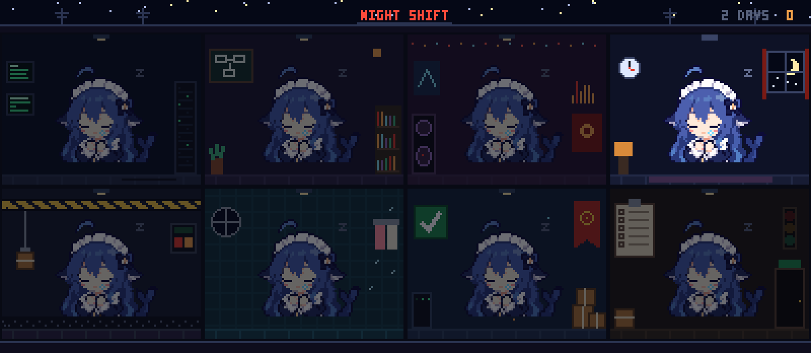
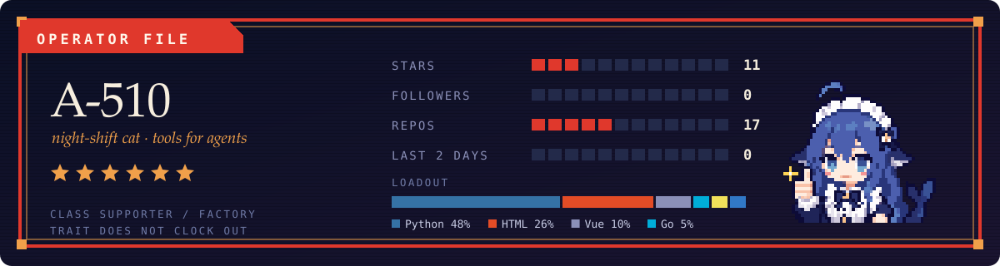

 

 

### 🏭 Now building

Small tools that sit between you and the models: MCP servers that give coding agents eyes and hands, and the odd scraper that walks files out of places they were never meant to leave.

 

### 🛰️ Selected work

 

### 🔧 Arsenal

 

### 🌙 Night shift log

<picture>
  <source media="(prefers-color-scheme: dark)" srcset="https://raw.githubusercontent.com/A-510/A-510/output/snake-dark.svg">
  
</picture>

 

### ✍️ House rules

Build the smallest thing that works, then keep it running. 
Automate the boring part; that is where the hours go. 
If it only works on your machine, it isn't shipped.

 

<picture>
  <source media="(prefers-color-scheme: dark)" srcset="assets/rule-dark.svg">
  
</picture>

НОЧНАЯ СМЕНА · night shift 

